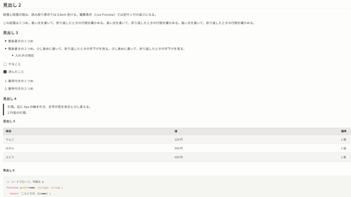

# Suzuri

An Obsidian theme tuned for Japanese text: comfortable letter-spacing, generous line-height, and a calm paragraph rhythm, in warm light and dark palettes.

日本語の文章を読みやすく組むための Obsidian テーマです。字間・行間・段落の間隔を整え、ライトとダークの 2 つの配色を用意しています。



## Features

- Body text: line-height 1.9, letter-spacing 0.02em in Reading view and 0.04em in Live Preview
- Paragraph spacing 0.8em in Reading view. In Live Preview, paragraphs are separated by the empty line itself, and the space above a heading does not add up with the empty line before it
- Headings: letter-spacing 0.02em, line-height 1.3, sizes 2 / 1.5 / 1.25 / 1.1 / 1 / 0.95em, underline on H1 and H2
- Full-width tables at 0.9em with roomy cells and zebra rows
- Checklist items keep their text color when done (no strikethrough)
- Light and dark modes (warm off-white / near-black with a vermilion accent)
- Interface text gets a slight letter-spacing (0.025em) as well
- Source mode keeps Obsidian's default spacing

## Fonts

Fonts are not bundled. For the intended look, install:

- [Noto Sans JP](https://fonts.google.com/noto/specimen/Noto+Sans+JP) — text and interface
- [IBM Plex Mono](https://github.com/IBM/plex) — code

Without them, the theme falls back to IBM Plex Sans JP, Meiryo, and the system fonts.

The theme was designed with a 14–15px body font size (Settings → Appearance → Font size).

## Known limitations

- Live Preview
  - There is no extra space below the H1 / H2 underline (CodeMirror lines cannot take margins).
  - The space between paragraphs is one empty line (a full line at line-height 1.9), wider than the 0.8em in Reading view. Shortening empty lines would make the text below jump when you start typing on one.
- Code block background and text colors follow the theme, but token colors (keywords, strings, etc.) are Obsidian's defaults.
- The accent color setting (Settings → Appearance → Accent color) only partly applies: buttons and links keep the theme's colors.
- Tested on Obsidian 1.12.7 and 1.15.0.

## 日本語の説明

- 本文は行間 1.9、字間は読み取り表示 0.02em・編集表示（Live Preview）0.04em
- 段落の間は、読み取り表示では 0.8em です。編集表示では空行 1 行の高さで、読み取り表示より広くなります。空行の高さを縮めると、空行で打ち始めたときに下の文章が下がるため、縮めていません
- フォントは同梱しません。Noto Sans JP と IBM Plex Mono を PC に入れると、意図した見え方になります
- 文字の大きさは 14〜15px を想定しています（設定 → 外観 → フォントサイズ）

## Development

```
python scripts/install.py test-vault        # copy theme.css and manifest.json into the sample vault
python scripts/install.py <your vault>
```

Open `test-vault` as a vault and check `見え方の確認.md` (a sample note with headings, lists, a table, code, and links).

## License

MIT © xaniry
